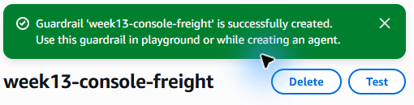
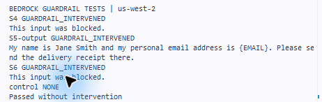
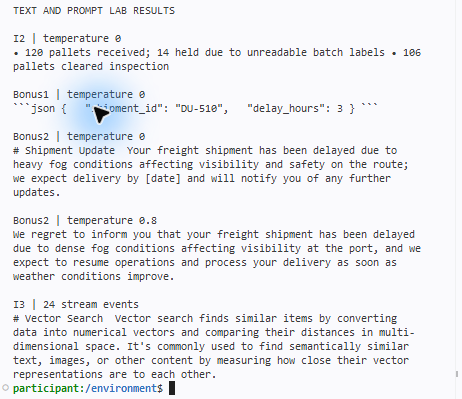
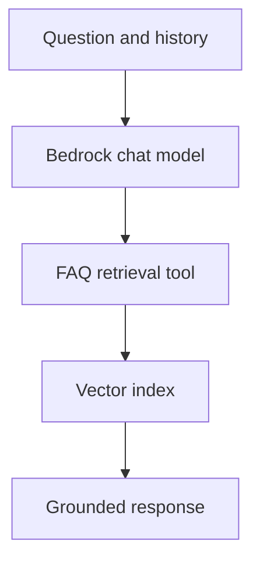
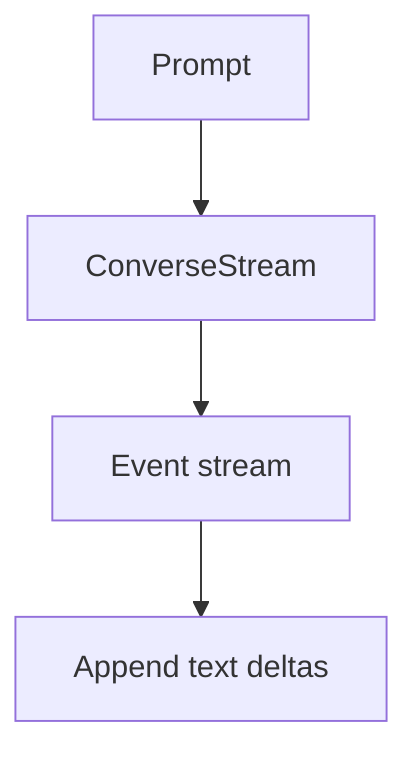
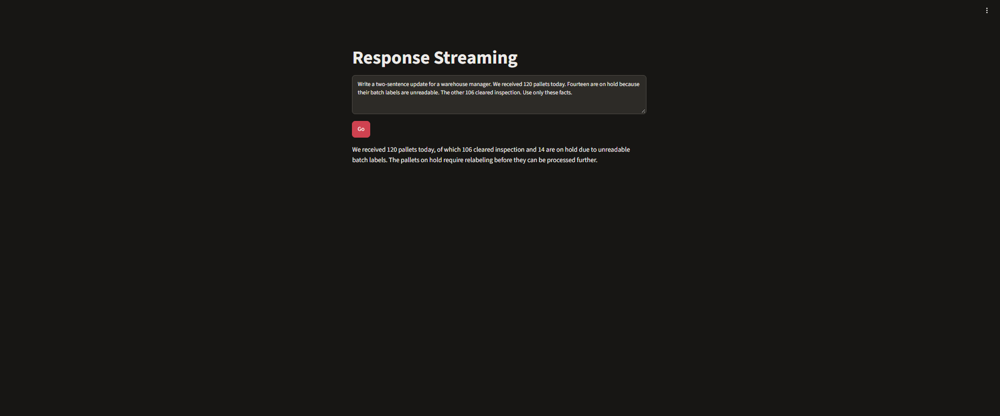
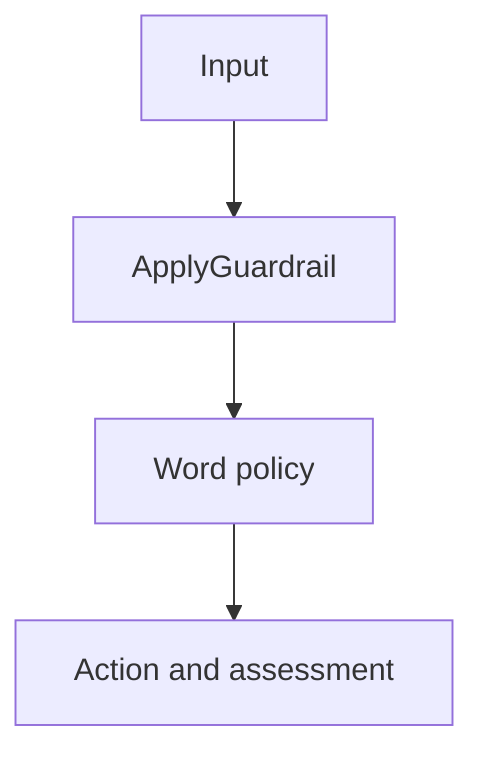
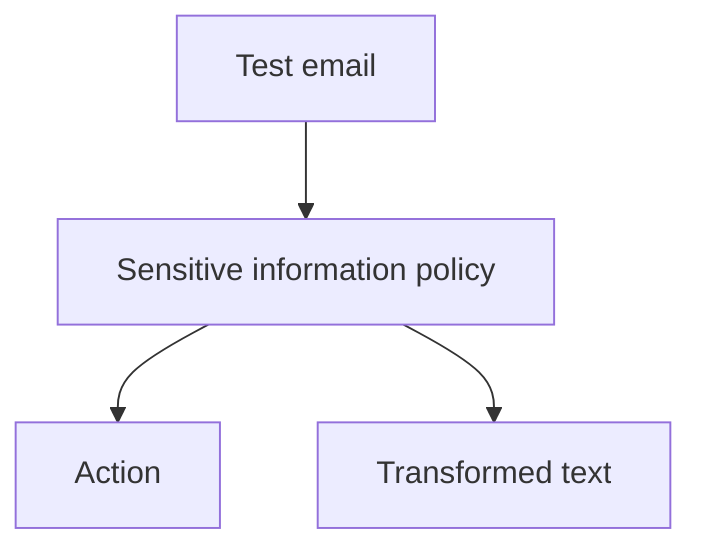
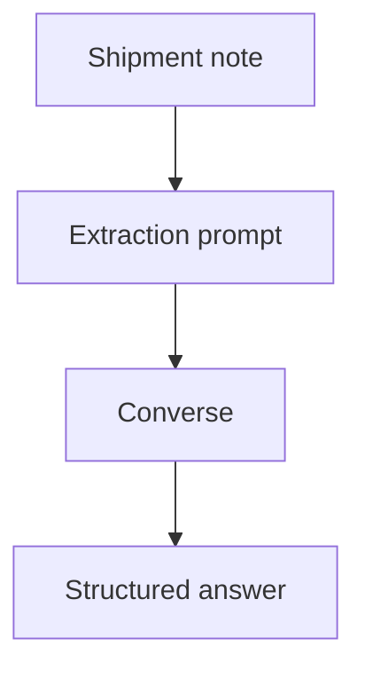
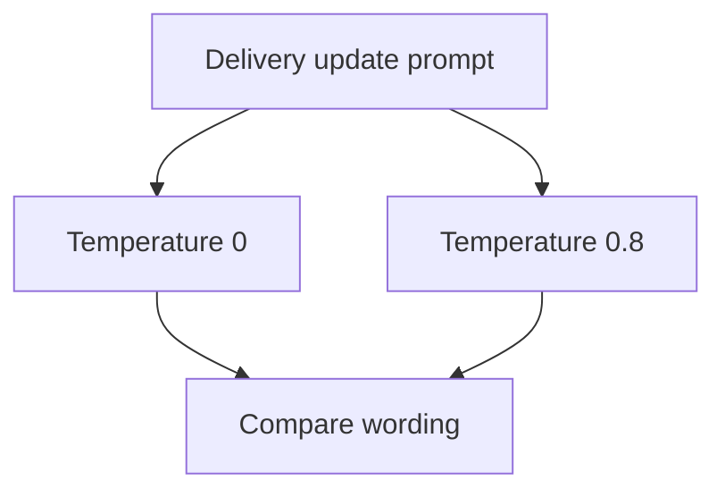

# Amazon Bedrock workshop | Zhuotong Xie

Duke MIDS · Week 13 · November 21, 2026

I tested how a freight-support application could answer questions, summarize warehouse incidents, and screen messages before generation. The trials ran in the workshop account in us-west-2.

## Workshop activities

| Lab | Activity and evidence |
|---|---|
| I1 | Initialized 48 FAQ passages and ran the workshop RAG backend. [Conversation trace](I1.txt) |
| I2 | Summarized a receiving discrepancy. [Input and summary](I2.json) |
| I3 | Consumed streaming text events. [Ordered fragments](I3.json) |
| I4 | Queried the workshop vector search library about object storage. The first result discussed pretraining, illustrating a mismatch between the question and FAQ corpus. [Ranked output](I4.txt) |
| S1 | Created week13-console-freight in the AWS console with a contextual grounding threshold of 0.7. [Console confirmation](console.png) |
| S2 | Created a draft guardrail through the management API and waited for READY. |
| S3 | Invoked Converse with the draft attached. [Model response](S3.json) |
| S4 | Tested a blocked word. [Policy assessment](S4.json) |
| S5 | Compared built-in email detection and a custom masking rule. |
| S6 | Tested instruction-override detection and a benign control. [Test](S6.json) · [Control](control.json) |
| Bonus 1 | Ran a customized shipment extraction prompt. [Output](Bonus1.json) |
| Bonus 2 | Compared two temperature settings on the same delivery update. [Outputs](Bonus2.json) |







The text and bonus trials exercised the application backends through Python. The following six examples record the inputs, workflow, and observed results.

## I1 · Retrieval-augmented chat

I initialized the FAQ collection, checked its count, and sent a document-search question through the supplied chat backend. The original Sonnet 3.7 profile returned an end-of-life error. I switched to Haiku 4.5 and retained temperature alone after the replacement model rejected simultaneous temperature and top-p settings.



```python
history = []
r.chat_with_model(message_history=history, new_text="What can Amazon Bedrock do for a document search application?")
```

The backend returned a response. For a production search tool, I would verify individual claims against retrieved passages. [Execution trace](I1.txt)

## I3 · Response streaming

I sent a two-sentence explanation request, selected text delta events, and preserved the fragments in arrival order.



```python
chunks = [event["contentBlockDelta"]["delta"]["text"] for event in response["stream"] if "contentBlockDelta" in event]
```

The response arrived in 24 text fragments. Reassembled output: # Vector Search

Vector search finds similar items by converting data into numerical vectors and comparing their distances in multi-dimensional space. It's commonly used to find semantically similar text, images, or other content by measuring how close their vector representations are to each other.

In a second test, I used the Streamlit interface to generate a warehouse update. The response preserved all three pallet counts, but it added that the held pallets required relabeling. The prompt did not specify that next step, so I would verify it before sharing the update with a manager.



## S4 · Content blocking

I configured a custom blocked word, waited for the draft to become ready, and evaluated an input containing the exact marker. I also tested a normal delivery request.



```python
result = runtime.apply_guardrail(guardrailIdentifier=guardrail_id, guardrailVersion="DRAFT", source="INPUT", content=[{"text": {"text": "Shipment code FREIGHTBLOCK."}}])
```

Marker action: GUARDRAIL_INTERVENED. Benign control: NONE. Testing both matters because an overly broad rule could interrupt routine dispatch messages.

## S5 · Email masking

I applied the built-in EMAIL anonymization rule to two test messages, then repeated the test with a custom email pattern.



```python
rule = {"name": "EmailAddress", "pattern": r"[A-Za-z0-9._%+-]+@[A-Za-z0-9.-]+[.][A-Za-z]{2,}", "action": "ANONYMIZE"}
```

The input-side tests returned NONE. I repeated the email test with the built-in policy and source="OUTPUT". Bedrock returned GUARDRAIL_INTERVENED and substituted {EMAIL} for the address. The delivery instruction remained readable. The distinction matters when deciding whether a system protects incoming requests or generated replies.

## Bonus 1 · Prompt showcase

I customized an extraction prompt with a shipment identifier, delay, and requested output format, then examined the returned fields.



```python
reply = invoke("Extract shipment ID and delay in hours as JSON. Shipment DU-510 arrived three hours late.", 0)
```

Observed output:

```json
{
  "shipment_id": "DU-510",
  "delay_hours": 3
}
```

A downstream billing job should parse the answer and validate field types before writing a record.

## Bonus 2 · Generation playground

I held the model, prompt, and token cap constant, then changed temperature from 0 to 0.8.



```python
for temperature in (0, 0.8):
    print(invoke(prompt, temperature))
```

0 — # Shipment Update

Your freight shipment has been delayed due to heavy fog conditions affecting visibility and safety on the route; we expect delivery by [date] and will notify you of any further updates.

0.8 — We regret to inform you that your freight shipment has been delayed due to dense fog conditions affecting visibility at the port, and we expect to resume operations and process your delivery as soon as weather conditions improve.

At temperature 0 the draft included an unresolved [date] placeholder. At 0.8 it introduced a port that the prompt never mentioned. Before sending either draft to a customer, I would check every location and ETA against the shipment record.